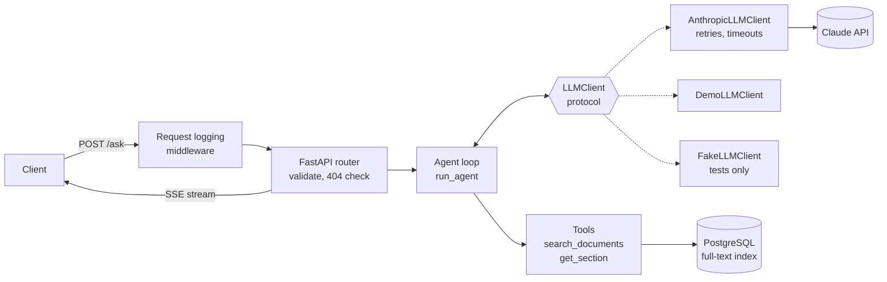

# Legal Doc Assistant

[](https://github.com/Wafinator/legal-doc-assistant/actions/workflows/ci.yml)

A FastAPI backend for asking questions about legal documents. You upload a contract or court
filing as plain text, it's stored in PostgreSQL, and a Claude agent answers questions by calling
two tools: **keyword search** across documents and **section lookup** by heading. The answer
streams back over **Server-Sent Events** as it's written.

The focus is backend engineering around an LLM rather than the LLM itself:

- **A hand-written agent loop** that runs tool calls until the model gives a final answer, with a
  step limit.
- **Reliability:** timeouts, retries with backoff, input validation, and errors that stay errors
  instead of crashes.
- **Structured JSON logs** with a request ID on every line, plus token usage and latency.
- **A test suite that runs offline:** the LLM client is injected, so tests use a fake model and
  real Postgres, with no API key.

Built with Python 3.12, FastAPI, SQLAlchemy 2, PostgreSQL 16, the Anthropic Python SDK (Claude
Haiku 5.5), pytest, Docker Compose and GitHub Actions.

---

## Quick start (no API key needed)

You need [Docker](https://www.docker.com/products/docker-desktop) and
[uv](https://docs.astral.sh/uv/getting-started/installation/). uv installs Python 3.12 for you.

```bash
git clone https://github.com/Wafinator/legal-doc-assistant.git
cd legal-doc-assistant
cp .env.example .env            # Windows PowerShell: Copy-Item .env.example .env
docker compose up -d --wait     # Postgres on localhost:5433
uv sync                         # creates .venv and installs dependencies
uv run uvicorn app.main:app --no-access-log
```

In a second terminal:

```bash
uv run python scripts/upload_samples.py
uv run python scripts/ask.py "How can the agreement be terminated?" --document-id 1
```

`.env.example` sets `LLM_MODE=demo`. In demo mode a scripted stand-in replaces Claude, so the
app runs with **no API key and no cost**. Everything except the model's decisions is real: the
agent loop, both tools, Postgres full-text search, SSE streaming and logging. Demo answers are
labeled `[Demo mode]` and report 0 tokens.

Interactive API docs: http://localhost:8000/docs

### Using Claude for real

1. Create a key in the [Claude Console](https://console.anthropic.com) (Settings → API Keys).
2. In `.env`, set `LLM_MODE=anthropic` and `ANTHROPIC_API_KEY=sk-ant-...`. `.env` is git-ignored.
3. Restart the server. Without a usable key, `/ask` returns `503` with a message saying what to
   set, instead of starting a stream.

With Haiku 5.5 at `effort=low`, one question (2–3 model calls) costs roughly a tenth of a cent.

---

## Example

`scripts/ask.py` is a small SSE client. It prints tool activity to stderr and the answer as it
streams.

### Real model (Claude Haiku 5.5)

```text
$ uv run python scripts/ask.py "How can the agreement be terminated?" --document-id 1
[tool] search_documents({"query": "termination", "document_id": 1})
[tool] search_documents({"query": "terminate notice", "document_id": 1})
[tool] get_section({"document_id": 1, "heading": "8. TERMINATION"})
The Master Services Agreement (Northwind / Harbor Freight) can be terminated in two ways, both set
out in Section 8 (TERMINATION):

1. **For convenience:** Either party may terminate the Agreement for convenience on sixty (60)
   days' written notice.
2. **For material breach:** Either party may terminate immediately if the other party materially
   breaches the Agreement and fails to cure the breach within fifteen (15) days of notice.

The Agreement also has a fixed initial term of two years from the Effective Date, "unless
terminated earlier under Section 8" (per the opening section of the Agreement). Section 4.2 is
noted as surviving termination for five years, which is relevant to what obligations continue
afterward.

[done] answered in 3 steps, 3620 ms, 3972 input / 459 output tokens
```

Two things this run shows:

- **Parallel tool calls:** the model ran both searches in one step, then fetched the section,
  then answered, so 3 tool calls took 3 steps. The loop runs every tool call in a step and sends
  all the results back in one message.
- **A citation slip:** the two-year-term quote comes from section `2. TERM`, which the model only
  saw inside a search snippet and never opened, so it's credited to "the opening section". The
  answer is right and the source label is wrong. This is the kind of error an eval set would
  catch (see [next steps](#limitations-and-next-steps)).

The run cost about $0.0006.

### Demo mode

The same question with `LLM_MODE=demo`, no API key:

```text
$ uv run python scripts/ask.py "How can the agreement be terminated?" --document-id 1
[tool] search_documents({"query": "terminated", "document_id": 1})
[tool] get_section({"document_id": 1, "heading": "termin"})
[Demo mode: no AI model was called; this answer is assembled from the tool results.] The closest
match is "Master Services Agreement (Northwind / Harbor Freight)", section "8. TERMINATION":
"Either party may terminate this Agreement for convenience on sixty (60) days' written notice.
Either party may terminate immediately if the other party materially breaches this Agreement and
fails to cure the breach within fifteen (15) days of notice."

[done] answered in 3 steps, 2129 ms, 0 input / 0 output tokens
```

On the wire it's plain SSE, one `event:` / `data:` pair per message (`curl -N` shows it live;
on Windows use `curl.exe`):

```text
$ curl -N -X POST localhost:8000/ask -H "content-type: application/json" \
    -d '{"question": "What is the governing law?", "document_id": 1}'

event: tool_call
data: {"id": "demo_1", "name": "search_documents", "input": {"query": "governing", "document_id": 1}}

event: tool_result
data: {"id": "demo_1", "name": "search_documents", "is_error": false, "preview": "{\"query\": ..."}

event: tool_call
data: {"id": "demo_2", "name": "get_section", "input": {"document_id": 1, "heading": "govern"}}

event: tool_result
data: {"id": "demo_2", "name": "get_section", "is_error": false, "preview": "{\"document_id\": 1, ..."}

event: token
data: {"text": "[Demo "}

...

event: done
data: {"stop_reason": "answered", "steps": 3, "usage": {"input_tokens": 0, "output_tokens": 0}, "latency_ms": 1309}
```

---

## API

| Method | Path | Description |
|---|---|---|
| `POST` | `/documents` | Upload `{title, content}`. Returns `201` with the stored document. |
| `GET` | `/documents?limit=20&offset=0` | Page of summaries, newest first. Content is left out; `char_count` is included. |
| `GET` | `/documents/{id}` | One document with its content. `404` if missing. |
| `POST` | `/ask` | `{question, document_id?}`. Returns a `text/event-stream`. |
| `GET` | `/health` | Liveness check. |

**`/ask` events:** `tool_call`, `tool_result` (with a 300-character preview), `token` (answer
text), `done` (`stop_reason`, `steps`, summed token `usage`, `latency_ms`), and `error`
(`llm_unavailable`, `internal_error` or `timeout`).

Validation errors (`422`), an unknown `document_id` (`404`) and a missing API key in
`LLM_MODE=anthropic` (`503`) are returned **before** the stream opens. Once streaming has started the status is already `200`, so later failures arrive as an
`error` event. Every response carries an `X-Request-ID` header; send your own (letters, digits,
`.`, `_`, `-`) to trace a request through the logs.

---

## Architecture



**How a question flows through `/ask`:**

1. **Validation:** the router checks the request body and that the document exists, then returns
   a streaming response.
2. **The agent loop** (`app/agent/loop.py`) sends the conversation and tool definitions to the
   model.
   - If the model asks for tools, the loop runs each one, sends all results back in a single
     message, and takes another step.
   - If the model answers, the loop stops.
   - It also stops after `AGENT_MAX_STEPS`, or when the model hits its output cap or declines.
3. **Events, not HTTP:** the loop yields events (`Token`, `ToolCall`, `ToolResultEvent`, `Done`)
   and knows nothing about HTTP. `app/api/sse.py` turns each event into an SSE frame.
4. **One interface for the model:** the loop only depends on `LLMClient`, which has a single
   method, `stream_turn`. The real client, the demo client and the test fake all implement it,
   and FastAPI dependency injection picks one.

```
app/
  main.py            app factory: middleware, routers, logging
  config.py          settings from env vars / .env (pydantic-settings)
  middleware.py      request ID + request log with full streamed latency
  logging_setup.py   JSON log formatter
  api/               documents.py, ask.py (routers), sse.py (wire format)
  agent/             loop.py, tools.py, events.py
  documents/         repository.py (SQL), sections.py (heading parser)
  llm/               client.py (protocol + Anthropic client), retry.py, demo.py
tests/
  unit/              pure functions: retry logic, section parsing
  integration/       real Postgres: endpoints, tools, agent loop, SSE
  fakes.py           FakeLLMClient, scripted turns, SDK error builders
  data/              a sample contract and court filing
scripts/             upload_samples.py, ask.py
```

---

## Design decisions

| Decision | Why |
|---|---|
| **Hand-written agent loop** rather than the SDK's tool runner | The loop is the core of the project. Owning it makes it easy to log every tool call, enforce a step limit, and test it step by step with a scripted fake. |
| **`LLMClient` protocol + dependency injection** | Tests and demo mode swap the model without touching the agent or the endpoint. The test suite never needs a key or network access. |
| **Own retries, SDK retries off** | Every retry is logged and unit-tested. Retries use exponential backoff with full jitter, honor `retry-after`, and cover 429, 5xx/529 and connection errors only, never 4xx. |
| **No retry after the first streamed token** | A retry would replay the answer from the start and the user would see duplicated text, so a mid-stream failure becomes an `error` event instead. |
| **Errors before the stream, events after** | HTTP status can only be set once. Validation and the 404 check run before the first byte; later failures become `error` events with a generic message (details only in logs). |
| **Postgres full-text search** (generated `tsvector` column + GIN index) | Real keyword search with stemming ("terminated" matches "termination"), ranking and highlighted snippets, without a separate search service or vector database. |
| **Heading parser with levels** | Legal documents nest (`3` → `3.1`, `III.` → `A.`), so asking for `III. ARGUMENT` returns its subsections, not an empty body. Sentence-like lines such as `Section 4.2 shall survive…` are not treated as headings. |
| **Tool errors go back to the model** | Unknown tools, invalid input, or a missing heading return an error result listing the available headings, so the model can correct itself instead of the request failing. |
| **Thinking blocks passed back unchanged** | Haiku 5.5 thinks by default. Each assistant turn is resent exactly as received, which the API requires for tool use with thinking. |
| **ASGI middleware instead of `@app.middleware`** | It wraps `send`, so the logged latency covers the whole stream, not just the time to the first byte. |
| **Sync SQLAlchemy** | FastAPI runs sync endpoints in a thread pool. At this scale it's simpler and makes test fixtures much easier than async. |

**Reliability settings** (all configurable via env vars):

| Setting | Default | What it limits |
|---|---|---|
| `LLM_CONNECT_TIMEOUT` | 5s | Time to connect to the API |
| `LLM_READ_TIMEOUT` | 30s | Longest gap between streamed chunks |
| `LLM_MAX_ATTEMPTS` | 3 | Attempts per model call, including the first |
| `AGENT_MAX_STEPS` | 6 | Model calls per question |
| `AGENT_TIMEOUT_S` | 60s | Wall-clock time for one `/ask` request |
| Input size | | Questions up to 2,000 characters, documents up to 500,000 |

**Logging:** one JSON object per line, for example (illustrative values):

```json
{"ts": "...", "level": "INFO", "logger": "app.llm.client", "event": "llm_call", "request_id": "68c9...", "model": "claude-haiku-5-5", "attempts": 1, "latency_ms": 1206, "input_tokens": 1830, "output_tokens": 96, "stop_reason": "end_turn"}
```

Event types: `request`, `llm_call`, `llm_retry`, `llm_call_failed`, `tool_call`, `agent_done`,
`agent_timeout`, `agent_failed`.

---

## Testing

```bash
docker compose up -d --wait
uv run pytest            # about 75 tests, a few seconds, no API key
uv run ruff check .      # lint
uv run ruff format .     # format
```

- **Unit tests** cover pure logic: retry classification, backoff timing (with an injected `sleep`
  and random source) and heading parsing.
- **Integration tests** run against a real Postgres test database (`legal_docs_test`). The schema
  is rebuilt once per run and every table is truncated before each test, so tests can't see each
  other's data.
- **The model is a `FakeLLMClient`** with scripted turns: text, tool calls, or exceptions raised
  before or partway through a stream. It records every call, so tests check what the agent sent
  (alternating roles, matching `tool_use` / `tool_result` IDs), not just what came back.
- **Endpoint tests** override the `get_llm_client` dependency and parse the SSE stream.
- **The tests are checked against deliberate bugs:** the code was broken on purpose (retrying
  after output had started, dropping a retryable status code, turning off stemming, summing usage
  wrongly) to confirm a test fails each time. One gap found this way, a stemming test that passed
  with stemming disabled, was fixed.

CI (GitHub Actions) runs lint, a format check and the full test suite against a Postgres 16
service container on every push and pull request.

---

## Limitations and next steps

- **Migrations:** tables are created at startup with `create_all`. A real deployment would use
  Alembic.
- **Plain text only:** PDF/DOCX parsing would go in front of `POST /documents`.
- **Keyword search only:** for questions phrased differently from the document, hybrid search
  (full-text + embeddings, e.g. pgvector) would improve recall.
- **No auth or multi-tenancy:** every document is visible to every caller.
- **Heading detection is heuristic:** it handles common contract and brief styles, but unusual
  formats may split oddly. A short ALL-CAPS line (like `LLC` in a signature block) counts as a
  heading.
- **Answer quality isn't measured:** the next step is an eval set of questions with expected
  sections and citations, scored automatically, so prompt or model changes can be compared. The
  citation slip in the example above is a real case it should catch.
- **Async:** switching to async SQLAlchemy and `AsyncAnthropic` would serve more concurrent
  streams per process.
